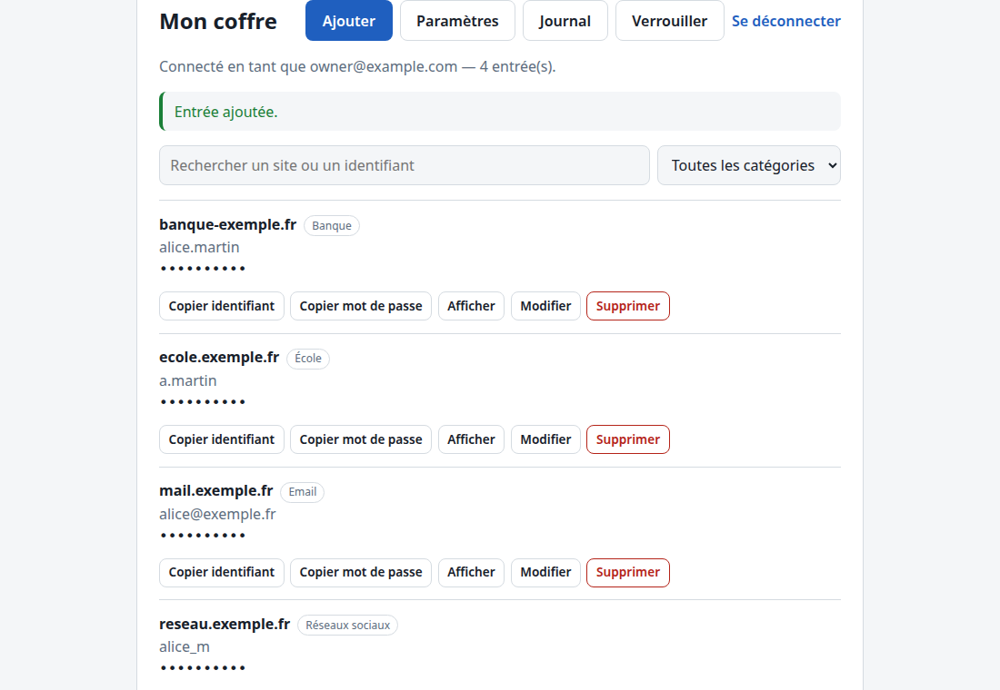
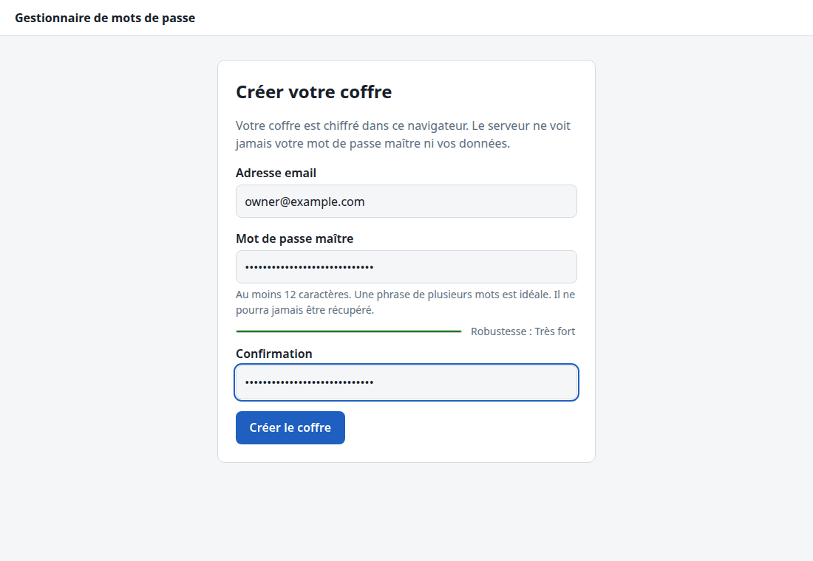
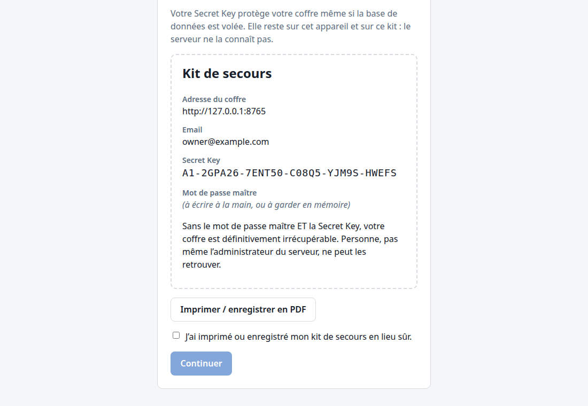
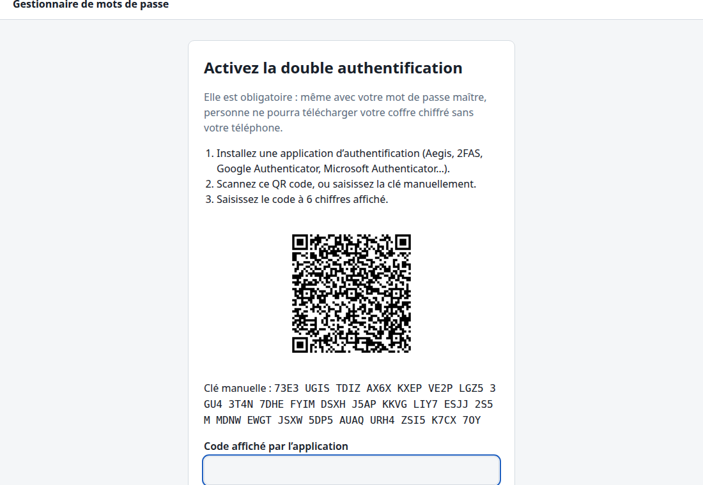
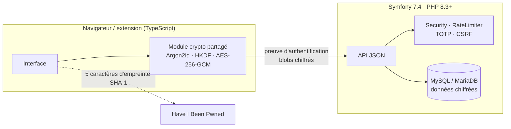

# Gestionnaire de mots de passe zero-knowledge

Coffre de mots de passe auto-hébergé où **tout le chiffrement a lieu dans le navigateur ou l'extension**. Le serveur ne reçoit jamais le mot de passe maître, ni la Secret Key, ni aucune clé, ni aucune donnée du coffre en clair : il stocke des blocs chiffrés, authentifie, limite les tentatives et journalise.

Projet de portfolio, conçu à partir des pratiques de Bitwarden et 1Password et des recommandations OWASP (ASVS 4.0 niveau 2).



## Fonctionnalités

- **Chiffrement côté client** : Argon2id + **Secret Key** de 128 bits (dérivation à deux secrets, comme 1Password), AES-256-GCM, clé de coffre aléatoire.
- **Double authentification TOTP obligatoire**, 10 codes de secours à usage unique ; le coffre chiffré n'est jamais servi avant le second facteur.
- **Coffre sur une seule page** : recherche, catégories, générateur, jauge de robustesse, alerte de réutilisation, copie avec effacement, verrouillage automatique.
- **Sauvegardes chiffrées autonomes** : lisibles sans serveur avec le mot de passe maître et la Secret Key ; restauration testée après la perte complète de la base.
- **Changement du mot de passe maître**, avec renouvellement facultatif de la clé du coffre et de la Secret Key.
- **Mots de passe divulgués** : vérification Have I Been Pwned par k-anonymat (5 caractères d'empreinte envoyés).
- **Extension Chrome** qui déchiffre localement et ne remplit que sur le bon domaine, en HTTPS, dans un champ réellement visible.
- **Journal de sécurité** et limitation des tentatives qui ne peut pas bloquer le propriétaire depuis ailleurs (device cookie OWASP).

| Inscription | Kit de secours | Double authentification |
|---|---|---|
|  |  |  |

## Architecture



```text
mot de passe maître ─ Argon2id(sel) ─┐
                                     ├─ XOR ─ clé maître ─┬─ HKDF « pm-wrap-v1 » → clé d'enveloppe (non exportable)
Secret Key ───────── HKDF(sel) ──────┘                    └─ HKDF « pm-auth-v1 » → preuve (seule valeur envoyée)

clé du coffre (aléatoire) ─ AES-256-GCM(clé d'enveloppe) → stockée chiffrée sur le serveur
entrée {site, identifiant, mot de passe, notes…} ─ AES-256-GCM(clé du coffre, AAD = UUID) → blob opaque
```

Détails : [plan d'architecture](docs/PLAN.md#4-architecture-cible), [modèle de menace](docs/MENACE.md), [décisions](docs/DECISIONS.md).

## Ce qu'un attaquant obtient

| Situation | Résultat |
|---|---|
| Vol de la base de données | Blocs chiffrés et empreintes : inexploitables sans la Secret Key, même avec un mot de passe maître faible. |
| Vol d'une sauvegarde | Idem. |
| Lecture du disque ou des sessions du serveur | Aucune clé : les sessions ne contiennent que l'identité de l'utilisateur. |
| Mot de passe maître volé (sans la Secret Key) | Inutilisable. |
| Preuve d'authentification interceptée | Ne déchiffre rien ; le coffre reste inaccessible sans le second facteur. |
| Serveur compromis activement (JavaScript modifié) | Limite assumée, commune aux coffres web ; l'extension n'en dépend pas. |

## Pile technique

| Couche | Technologies |
|---|---|
| Serveur | PHP 8.3+ (versions corrigées imposées), Symfony 7.4 LTS, Doctrine, MySQL 8 / MariaDB 11.4 |
| Client | TypeScript strict, esbuild, WebCrypto, Argon2id (`hash-wasm`), sans framework UI, compatible Trusted Types |
| Extension | Chrome MV3, service worker, aucun script injecté en permanence |
| Qualité | PHPUnit, PHPStan niveau 8, PHP-CS-Fixer, Vitest, ESLint, Playwright, CI GitHub Actions (PHP 8.3/8.4/8.5 × MySQL/MariaDB) |

Les choix sont justifiés dans [docs/DECISIONS.md](docs/DECISIONS.md) (18 décisions).

## Tests

| Suite | Contenu |
|---|---|
| PHPUnit (74 tests) | API, isolation entre comptes, limitation, device cookie, double authentification (vecteurs RFC 6238), migrations |
| Vitest (47 tests) | Crypto (vecteurs Argon2id de référence et libsodium, HKDF RFC 5869), Secret Key, générateur, HIBP, règles de domaine de l'extension |
| Playwright (31 tests) | Parcours complets dans Chromium, extension chargée ; **aucun secret dans le trafic ni en base** sur une session complète ; restauration après sinistre |

## Démarrer

- Développement local (sans Docker) : [docs/DEVELOPPEMENT.md](docs/DEVELOPPEMENT.md)
- Déploiement : [mutualisé](docs/deploy/mutualise.md) ou [VPS](docs/deploy/vps.md)
- Extension : [extension/README.md](extension/README.md)
- Restaurer une sauvegarde : [docs/RESTAURATION.md](docs/RESTAURATION.md)

## Sécurité

Signaler une vulnérabilité : [SECURITY.md](SECURITY.md). Limites connues : [docs/MENACE.md](docs/MENACE.md). Revue finale (OWASP ASVS niveau 2 et relecture indépendante) : [docs/REVUE_SECURITE.md](docs/REVUE_SECURITE.md).

## Licence

[AGPL-3.0-or-later](LICENSE) — © dev-Chris06.
