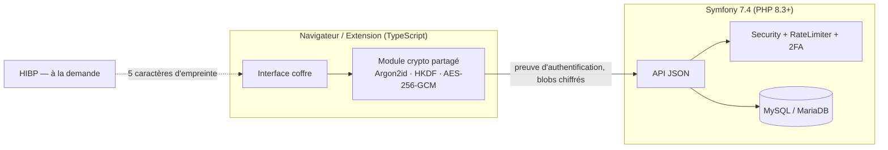

# Plan de refonte — Gestionnaire de mots de passe zero-knowledge

> Statut : **validé, non commencé** — rédigé le 2026-10-28.
> Ce document est la référence de travail. Toute déviation est proposée, justifiée et validée avant d'être appliquée, puis reportée ici.

## Sommaire

1. [Contexte](#1-contexte)
2. [Décisions arrêtées](#2-décisions-arrêtées)
3. [Règles de travail](#3-règles-de-travail)
4. [Architecture cible](#4-architecture-cible)
5. [Phases](#5-phases)
6. [Critères de fin du projet](#6-critères-de-fin-du-projet)
7. [Limites acceptées](#7-limites-acceptées)
8. [Hors périmètre](#8-hors-périmètre)
9. [Sources](#9-sources)

---

## 1. Contexte

L'audit du 2026-10-28 a montré que l'application actuelle (PHP procédural, chiffrement **côté serveur**, clé AES stockée dans la session PHP) présente un défaut structurel : le serveur voit le mot de passe maître et tous les secrets. S'y ajoutent un risque de déni de service (`usleep` dans la limitation), un verrouillage abusif possible du propriétaire, des sauvegardes non restaurables, un jeton AJAX jamais vérifié et un module de limitation trop complexe.

Le projet étant en conception (données de test uniquement) et **aucune V2 n'étant prévue**, la décision est de **reconstruire** l'application sur une architecture zero-knowledge, en repartant d'un schéma vierge.

## 2. Décisions arrêtées

| # | Sujet | Décision | Justification courte |
|---|---|---|---|
| D1 | Modèle de chiffrement | **Zero-knowledge, côté client** | Le serveur ne doit jamais voir de secret (modèle Bitwarden / 1Password / Proton). |
| D2 | Données existantes | **Repartir de zéro** | Données de test uniquement ; pas de migration. |
| D3 | KDF | **Argon2id** (WASM, `hash-wasm`), m = 64 MiB, t = 3, p = 1, paramètres stockés par compte | Résistance mémoire aux attaques GPU ; recommandé par OWASP ; proposé par Bitwarden. |
| D4 | Second secret | **Secret Key 128 bits** (dérivation à deux secrets, à la 1Password) | Rend une base ou une sauvegarde volée incraquable. |
| D5 | Double authentification | **TOTP + 10 codes de secours, obligatoire** | Universel, simple dans l'extension ; empêche de télécharger le coffre chiffré avec une preuve volée. |
| D6 | Mots de passe compromis | **HIBP à la demande** (k-anonymat) | Fonction attendue d'un gestionnaire ; aucune donnée exploitable envoyée. |
| D7 | Backend | **PHP 8.3+ / Symfony 7.4 LTS** (API JSON + Twig minimal) | Composants de sécurité éprouvés (RateLimiter, Security, CSRF, 2FA) au lieu de code maison ; choix de Proton ; LTS jusqu'en 2029. |
| D8 | Frontend et extension | **TypeScript strict + esbuild**, sans framework UI | Typage du code crypto ; un seul module crypto partagé web/extension ; pas de dépendance d'exécution lourde. |
| D9 | Base de données | **MySQL 8.0 en local**, compatibilité **MariaDB 11.4** testée en CI | Les hébergeurs fournissent l'un ou l'autre ; Doctrine masque les différences. |
| D10 | Hébergement | **Au choix : mutualisé (Alwaysdata de référence) ou VPS sans Docker** | Le PC de développement n'a pas la virtualisation ; contrainte : rien qui exige Redis, workers ou Docker. |
| D11 | Utilisateurs | **Un seul compte** : inscriptions fermées après le premier. Par prudence, chaque donnée reste rattachée à son compte et vérifiée à chaque accès. **Pas de démo en ligne** | Aucune instance publique = aucune surface d'attaque vers le coffre réel. Si la fermeture des inscriptions échouait (bug, requêtes simultanées), un second compte ne pourrait pas lire le premier ; les tests le prouvent avec deux comptes créés directement en base. Aucune fonctionnalité multi-utilisateur (partage, administration). |
| D12 | Navigateurs de l'extension | **Chrome / Chromium / Edge (MV3)** | Toutes les protections prévues y sont disponibles (`storage.session` en accès restreint). |
| D13 | Langue | **En anglais** : tous les noms choisis par le développeur (fonctions, variables, classes, tables, colonnes), les commentaires et les messages de commit. **En français** : l'interface (textes visibles par l'utilisateur) et la documentation du dépôt (`README`, `docs/`) | Le framework est en anglais : des noms français produiraient un mélange (`getUser()->getMotDePasseMaitre()`). Convention attendue par un recruteur et en open source. |
| D14 | Licence | **AGPL-3.0** | Norme du domaine (Vaultwarden, Passbolt) ; une version modifiée hébergée doit publier son code. |
| D15 | Présentation | **README « portfolio »** (captures, GIF, schémas) + **vidéo de démonstration** (2–3 min) | Pas d'instance publique ; le README et la vidéo suffisent à 95 % des visiteurs. |
| D16 | Échéance | **Aucune** | Qualité avant vitesse ; avancement phase par phase. |
| D17 | Niveau de correctifs PHP | **PHP ≥ 8.3.36, 8.4.27 ou 8.5.12** (correctifs du 2026-10-21 contre « PHP2Shell », CVE-2026-109618 et CVE-2026-109619), imposé par `composer.json`, vérifié en CI et au déploiement ; `session.upload_progress.enabled = 0` (atténuation de CVE-2026-109619 et de CVE-2026-115560, encore sans correctif) | Failles d'exécution de code à distance sans authentification, activement exploitées. |

Les décisions détaillées (contexte, alternatives, conséquences) sont consignées dans `docs/DECISIONS.md` (ADR) dès la phase 0.

## 3. Règles de travail

1. **Une branche et une PR par phase** (`refonte/phase-N-<slug>`), fusionnées dans `main` dans l'ordre. `main` est en chantier pendant la refonte ; le README l'indique.
2. **Validation à la fin de chaque phase** : présentation du diff, des résultats de tests et des écarts au plan. Aucun commit ni push sans accord explicite.
3. **Tests écrits avec le code.** Aucune primitive crypto sans vecteurs de test ; aucun endpoint sans test du contrat, des droits et des limites.
4. **Pas d'ajout hors plan.** Toute découverte est signalée et ajoutée ici après accord.
5. **Invariant absolu** : le serveur ne reçoit jamais le mot de passe maître, la Secret Key, la clé maître, la clé de coffre ni un secret en clair. Une vérification automatique du trafic (phase 9) le prouve.
6. **Dépendances minimales et justifiées.** Toute nouvelle dépendance est listée ici avec sa raison ; `composer audit` et `npm audit` tournent en CI.
7. **Rien n'est exécuté sur le serveur qui ne puisse l'être sur un mutualisé** (pas de Redis, pas de worker, pas de Docker en production).

## 4. Architecture cible

### 4.1 Vue d'ensemble



Le serveur **stocke, authentifie, limite et journalise**. Il ne chiffre ni ne déchiffre aucune donnée du coffre. Seule exception documentée : le secret TOTP (voir 4.6), qui protège l'authentification et jamais le contenu du coffre.

### 4.2 Hiérarchie des clés

```text
Secret Key (128 bits, générée sur l'appareil, jamais envoyée)
mot de passe maître

k_pwd  = Argon2id(mot de passe maître, salt, m=64MiB, t=3, p=1)       → 32 octets
k_sk   = HKDF-SHA256(Secret Key, salt, info="pm-secret-key-v1")       → 32 octets
master = k_pwd XOR k_sk                                               (dérivation à deux secrets)

wrap_key   = HKDF-SHA256(master, info="pm-wrap-v1")    → clé AES-GCM non exportable
auth_proof = HKDF-SHA256(master, info="pm-auth-v1")    → 32 octets, envoyés au serveur

vault_key  = 256 bits aléatoires, générés à l'inscription
wrapped_vault_key = AES-256-GCM(wrap_key, vault_key, AAD="pm-vault-key-v1")

Serveur : salt, paramètres KDF, hash(auth_proof) via PasswordHasher, wrapped_vault_key
```

- **Format de la Secret Key** : `A1-XXXXXX-XXXXXX-XXXXX-XXXXX-XXXXX` (préfixe de version, 128 bits en 26 chiffres base32 Crockford, puis un symbole de contrôle modulo 37). Elle est stockée dans le `localStorage` de chaque navigateur utilisé et dans `chrome.storage.local` pour l'extension.
- **Kit de secours** : une page imprimable générée côté client contient l'adresse du serveur, l'email, la Secret Key et un champ vide pour écrire le mot de passe maître à la main. L'utilisateur l'imprime ou l'enregistre en PDF via le navigateur.
- **Planchers côté client** : le client refuse tout paramètre KDF inférieur à m = 64 MiB et t = 3 (protection contre une baisse imposée par un serveur malveillant). L'extension mémorise les paramètres déjà vus et alerte s'ils baissent.
- **Clé de coffre non exportable** : en usage normal, `vault_key` est importée avec `extractable: false`. Seuls le changement de mot de passe et le renouvellement de la clé la déballent temporairement en mode exportable.

### 4.3 Format des données chiffrées

- **Blob d'entrée** : `base64( 0x01 ‖ iv[12] ‖ ciphertext ‖ tag[16] )`
  - le texte chiffré est un JSON `{ site, username, password, category, notes, includeSubdomains }` ;
  - AAD = `"pm-entry-v1:" + uuid`, ce qui empêche le serveur d'échanger deux entrées ;
  - l'octet de version permet de faire évoluer le format.
- **Sauvegarde** (`pm-backup-v2`) : JSON autonome `{ format, exportedAt, kdf: {algo, m, t, p}, salt, wrappedVaultKey, entries: [{uuid, blob}] }`. Elle se déchiffre avec le mot de passe maître et la Secret Key valables au moment de l'export, sans aucun serveur. Un vol de la sauvegarde seule ne permet rien.

### 4.4 Parcours d'authentification

```text
1. POST /api/auth/prelogin {email}
      → {kdf, salt}  (email inconnu : salt = HMAC(APP_SECRET, "prelogin|"+email)[0..16],
                      paramètres par défaut → réponse indiscernable)
2. Client : vérifie les planchers KDF, dérive master, auth_proof, wrap_key
3. POST /api/auth/login {email, authProof}
      → 2FA active : {step: "2fa"}         (session « en attente », 5 min, aucun secret renvoyé)
      → 2FA pas encore configurée : {step: "2fa-setup"} (activation imposée)
4. POST /api/auth/2fa/check {code | backupCode}
      → {step: "done"} ; session complète, identifiant de session régénéré
5. GET /api/vault → {wrappedVaultKey, entries[]}   (uniquement après l'étape 4)
6. Client : déballe vault_key en local, déchiffre les entrées
```

- **Déverrouillage** (session encore valide, coffre verrouillé localement) : le mot de passe maître seul suffit, sans 2FA. C'est une opération locale.
- **Durées** : la session serveur expire après 15 min d'inactivité et au plus 4 h. Le verrouillage local intervient après 5 min d'inactivité ou 5 min d'onglet caché dans le web, et après 15 min dans l'extension.

### 4.5 Endpoints de l'API

| Méthode | Route | Rôle | Protection |
|---|---|---|---|
| POST | `/api/auth/prelogin` | Paramètres KDF | Limite IP |
| POST | `/api/auth/register` | Création du compte (fermée après le premier) | Limite IP, CSRF |
| POST | `/api/auth/login` | Vérification de `authProof` | Limiteurs multi-axes, device cookie, CSRF |
| POST | `/api/auth/2fa/check` | Code TOTP ou code de secours | Limite 2FA, session en attente |
| POST | `/api/auth/logout` | Déconnexion | CSRF |
| GET | `/api/session` | État de session + jeton CSRF | — |
| POST | `/api/2fa/setup` | Génère un secret en attente + QR (SVG) | `authProof` re-saisi |
| POST | `/api/2fa/enable` | Active la 2FA, renvoie 10 codes de secours | Code valide |
| POST | `/api/2fa/disable` | Désactive (interdit si 2FA obligatoire) | `authProof` + code |
| POST | `/api/2fa/backup-codes` | Régénère les codes | `authProof` + code |
| GET | `/api/vault` | Clé de coffre chiffrée + blobs | Session complète |
| POST | `/api/entries` | Création `{uuid, blob}` | Session, taille ≤ 64 Ko, quota |
| PUT | `/api/entries/{uuid}` | Modification `{blob, version}` → 409 en cas de conflit | Session |
| DELETE | `/api/entries/{uuid}` | Suppression | Session |
| POST | `/api/entries/batch` | Import / renouvellement de clé (transaction) | Session, ≤ 5 000 entrées |
| POST | `/api/account/password` | Changement du mot de passe maître (± renouvellement de la clé) | `authProof` actuel, limite REAUTH |
| GET | `/api/audit-log` | Journal paginé | Session |

**Protections communes** :
- session complète exigée, sauf pour les routes d'authentification ;
- vérification `Origin` / `Sec-Fetch-Site` ;
- en-tête `X-PM-Client: 1` ;
- cookies `SameSite=Strict` ;
- jeton CSRF sur toutes les mutations ;
- aucun en-tête CORS, sauf l'origine exacte de l'extension (`EXTENSION_ORIGIN`).

### 4.6 Sécurité serveur

- **Cookies** : `__Host-pm_session` (`Secure`, `HttpOnly`, `SameSite=Strict`, `Path=/`). Sessions stockées en base (`PdoSessionHandler`), ce qui permet de révoquer toutes les sessions lors d'un changement de mot de passe maître.
- **Limitation des tentatives** (`symfony/rate-limiter`, stockage compatible mutualisé) : des fenêtres glissantes superposées remplacent l'escalade maison.

  | Limiteur | Fenêtre courte | Fenêtre longue |
  |---|---|---|
  | Paire IP + email | 5 / 15 min | 20 / 24 h |
  | IP | 30 / h | 100 / 24 h |
  | Email (sans device cookie) | 10 / h | 30 / 24 h |
  | Appareil (avec device cookie) | 10 / 15 min | — |
  | 2FA | 5 / 15 min par compte | — |
  | Re-authentification | 5 / 15 min | — |
  | Inscription | 5 / h par IP | — |
  | prelogin | 60 / h par IP | — |

- **Device cookie** (recommandation OWASP) : `__Host-pm_device` contient un nonce et un HMAC(`APP_SECRET`) ; seul le hash du nonce est stocké en table `trusted_device`. Avec un cookie valide, les limiteurs Email et IP ne s'appliquent plus, seul le limiteur Appareil compte, et le propriétaire ne peut plus être bloqué par un tiers. **Il ne dispense jamais de la 2FA.** Tous les device cookies sont révoqués lors d'un changement de mot de passe maître.
- **Proxies de confiance** : `framework.trusted_proxies` et `trusted_headers` sont configurés par `.env` (vide par défaut).
- **Erreurs** : en cas d'erreur sur la limitation, la connexion est refusée et l'erreur journalisée (fail-closed). Les traces ne sont jamais renvoyées au client.
- **Secret TOTP** : chiffré en AES-256-GCM avec une clé HKDF(`APP_SECRET`, `"pm-totp-v1"`), AAD = id utilisateur. Une fuite de la base seule ne l'expose pas.
- **Codes de secours** : 10 codes de 60 bits, stockés en HMAC-SHA256, à usage unique.
- **Journal** (`audit_log`) : actions et uuid uniquement, jamais de nom de site (le serveur ne les connaît pas). Rétention de 90 jours, purgée par une commande cron.
- **En-têtes** :
  - CSP : `default-src 'self'; script-src 'self' 'nonce-…' 'wasm-unsafe-eval'; style-src 'self'; img-src 'self' data:; connect-src 'self' https://api.pwnedpasswords.com; frame-ancestors 'none'; base-uri 'none'; form-action 'self'; object-src 'none'; require-trusted-types-for 'script'; trusted-types 'none'` ;
  - HSTS, `X-Content-Type-Options`, `Referrer-Policy: no-referrer`, `Permissions-Policy`, COOP / CORP `same-origin` ;
  - `Cache-Control: no-store` sur l'API et la page du coffre.

### 4.7 Schéma de base (Doctrine, migrations versionnées)

| Table | Colonnes principales |
|---|---|
| `app_user` | id, email (unique), kdf_algo, kdf_memory, kdf_iterations, kdf_parallelism, kdf_salt, auth_hash, wrapped_vault_key, totp_secret_enc, totp_pending_enc, totp_enabled_at, totp_last_counter, created_at, updated_at |
| `vault_entry` | uuid (binaire, PK), user_id (FK, cascade), ciphertext, version, created_at, updated_at |
| `backup_code` | id, user_id, code_hmac (unique par utilisateur), used_at |
| `trusted_device` | id, user_id, nonce_hash (unique), created_at, last_used_at |
| `audit_log` | id, user_id (nullable), action, detail, ip, user_agent, created_at |
| `sessions` | table standard de `PdoSessionHandler` |
| fichiers (`var/`) | stockage du RateLimiter et verrous (`flock`), compatibles mutualisé |

### 4.8 Organisation du dépôt

```text
bin/ config/ migrations/ public/ src/ templates/ tests/     ← Symfony
  src/Controller/Api/   src/Security/   src/Entity/   src/Service/   src/Command/
frontend/
  packages/crypto/      ← module crypto partagé (TypeScript)
  web/                  ← application du coffre (TypeScript) → public/build/
extension/
  src/                  ← extension MV3 (TypeScript) → extension/dist/
tests/e2e/              ← Playwright
docs/                   ← PLAN, DECISIONS, MENACE, SECURITY, déploiement
deploy/                 ← script VPS, configuration Caddy, pool PHP-FPM, archive mutualisé
```

### 4.9 Dépendances prévues

| Paquet | Côté | Raison |
|---|---|---|
| `symfony/*` 7.4 (framework, security, rate-limiter, twig, uid, …) | Serveur | Socle (D7) |
| `doctrine/orm`, `doctrine/doctrine-migrations-bundle` | Serveur | Accès base et migrations versionnées |
| `symfony/monolog-bundle` | Serveur | Journalisation des erreurs (fichier, compatible mutualisé) |
| `scheb/2fa-bundle`, `scheb/2fa-totp`, `scheb/2fa-backup-code` | Serveur | Bibliothèque de référence pour la 2FA sous Symfony (D5) |
| `endroid/qr-code` | Serveur | QR code en SVG (remplace l'ancienne copie de `phpqrcode`) |
| `hash-wasm` | Client | Argon2id en WASM (D3) |
| `esbuild`, `typescript`, `vitest`, `eslint`, `@playwright/test` | Développement uniquement | Build et tests |
| `phpunit`, `phpstan` (+ symfony, doctrine), `php-cs-fixer` | Développement uniquement | Qualité |
| `dama/doctrine-test-bundle` | Développement uniquement | Chaque test PHP s'exécute dans une transaction annulée |

Toutes ces licences (MIT, Apache-2.0) sont compatibles avec l'AGPL-3.0.

---

## 5. Phases

Effort total estimé : **≈ 21 jours de travail effectif**, sans échéance (D16).

| # | Phase | Effort |
|---|---|---|
| 0 | Fondations | 2 j |
| 1 | Modèle de données et socle de sécurité | 1,5 j |
| 2 | Module crypto partagé | 2 j |
| 3 | Inscription et connexion zero-knowledge | 2,5 j |
| 4 | Double authentification | 1,5 j |
| 5 | Coffre (application sur une seule page) | 3 j |
| 6 | Mot de passe maître, sauvegarde, HIBP | 2 j |
| 7 | Extension Chrome | 3 j |
| 8 | Durcissement et déploiement | 2 j |
| 9 | Documentation, revue finale, présentation | 1,5 j |

### Phase 0 — Fondations (2 j)

**Objectif** : un socle vide mais outillé, dans lequel chaque régression est visible.

- [x] Poser le tag `avant-refonte` sur l'état actuel (référence historique), puis supprimer l'ancien code (`pages/`, `ajax/`, `includes/`, `config/`, `assets/`, `extension-chrome/`, `migrations/`, `database.sql`, `tests/`, `.htaccess`, `public/router.php`).
- [x] Squelette Symfony 7.4 minimal (`symfony/skeleton`), PHP ≥ 8.3 déclaré dans `composer.json`, licence `AGPL-3.0-or-later`.
- [x] Fichier `LICENSE` (texte AGPL-3.0), SPDX dans `composer.json` et `package.json`.
- [x] Convention de commit en anglais (Conventional Commits : `feat:`, `fix:`, `docs:`, `test:`, `chore:`…), décrite dans `CONTRIBUTING.md`.
- [x] Outils PHP : PHPUnit, PHPStan niveau 8 (+ extensions Symfony et Doctrine), PHP-CS-Fixer.
- [x] Outils front : `package.json` (Node ≥ 20), TypeScript `strict`, esbuild (cibles `public/build/` et `extension/dist/`), Vitest, ESLint, Playwright (Chromium).
- [x] CI GitHub Actions :
  - matrice PHP 8.3 / 8.4 × MySQL 8.0 / MariaDB 11.4 ;
  - lint, PHPStan, PHPUnit, Vitest, build, Playwright ;
  - `composer audit`, `npm audit --omit=dev` ;
  - garde-fou anti-`innerHTML` / `eval`.
- [x] `docs/DECISIONS.md` : ADR-001 à ADR-017 (une par décision D1–D17).
- [x] Guide d'installation du poste de développement **sans Docker** (PHP local, MySQL 8 local, Node).
- [x] README : bandeau « refonte en cours », lien vers ce plan.

- [x] Exigence de version PHP corrigée (D17) : contrainte `composer.json`, plateforme Composer fixée à 8.3.36, script `tools/check-php-platform.php` exécuté en CI, `public/.user.ini` désactivant `session.upload_progress`.

**Terminé quand** : la CI est verte sur le squelette, `GET /` renvoie une page Twig vide avec les en-têtes de sécurité, et un test Playwright « la page s'affiche » passe.

**Écarts constatés lors de la réalisation** (validés en fin de phase) :
- l'abonné des en-têtes de sécurité et le nonce CSP sont réalisés dès la phase 0, car le critère de fin l'exige (la phase 1 ne fera que les compléter) ;
- la matrice MySQL / MariaDB de la CI arrive en phase 1, avec la base de données ; la matrice PHP couvre 8.3, 8.4 et 8.5 ;
- les documents décrivant l'ancienne application (`INSTALL.md`, `docs/MENACE.md`, `docs/RATE_LIMITING.md`, `docs/TEST_GUIDE.md`) sont supprimés ; ils restent consultables sous le tag `avant-refonte` et seront réécrits en phase 9.

### Phase 1 — Modèle de données et socle de sécurité (1,5 j)

- [x] Entités Doctrine et migration initiale (section 4.7).
- [x] Sessions en base (`PdoSessionHandler`), cookie `__Host-pm_session` en production, expiration après 15 min d'inactivité (la durée absolue de 4 h arrive avec l'authentification, phase 3).
- [x] Abonné d'événements pour les en-têtes de sécurité, avec nonce CSP par requête exposé à Twig (réalisé en phase 0).
- [x] Middleware API : vérification `Origin` / `Sec-Fetch-Site`, en-tête `X-PM-Client`, réponses JSON d'erreur uniformes, refus de tout CORS sauf `EXTENSION_ORIGIN`.
- [x] Protection CSRF des mutations : jeton de session envoyé dans `X-CSRF-Token`, corps JSON obligatoire, en plus des contrôles d'origine.
- [x] Configuration `trusted_proxies` par `.env`.
- [x] Variables `.env` documentées : `APP_SECRET`, `DATABASE_URL`, `TRUSTED_PROXIES`, `EXTENSION_ORIGIN`, `LOCK_DSN`.
- [x] Commande `app:purge` (journal de plus de 90 jours, sessions expirées, appareils inactifs depuis plus de 180 jours).

**Tests** : migration jouée sur MySQL et MariaDB ; présence des en-têtes ; requête sans `X-PM-Client` → 403 ; `Origin` étranger → 403 ; `X-Forwarded-For` ignoré sans proxy déclaré.

**Écarts constatés lors de la réalisation** :
- table `app_user` au lieu de `user`, et colonne `ciphertext` au lieu de `blob` (mots réservés en SQL) ;
- le jeton CSRF utilise le gestionnaire de jetons à session de Symfony plutôt que le gestionnaire « same-origin » : la vérification d'origine est faite à part par le middleware, et le jeton lié à la session est plus simple à utiliser depuis l'extension ;
- pas de variable `REGISTRATION_OPEN` : la fermeture des inscriptions après le premier compte est automatique (phase 3) ;
- la route `GET /api/session` est livrée dès cette phase, car elle sert de support aux tests des protections de l'API ;
- un environnement Symfony `e2e` (configuré comme la production, sur HTTP et avec la base de test) sert aux tests Playwright, qui exercent ainsi les vraies sessions en base ;
- dépendances ajoutées : `symfony/monolog-bundle` (journaux d'erreurs), `symfony/lock`, `dama/doctrine-test-bundle` et `phpstan/phpstan-doctrine` (développement).

### Phase 2 — Module crypto partagé (2 j)

**Fichiers** : `frontend/packages/crypto/` (TypeScript, aucune dépendance hors `hash-wasm`), importé par le web et l'extension.

**API du module** :
- [x] `generateSalt`, `generateSecretKey`, `formatSecretKey`, `parseSecretKey` (avec caractère de contrôle) ;
- [x] `deriveMaster(password, secretKey, salt, params)` : Argon2id + HKDF + XOR ;
- [x] `assertKdfFloor(params)` : planchers de la section 4.2 ;
- [x] `deriveSubkeys(master)` → `{ wrapKey (non exportable), authProof }` ;
- [x] `generateVaultKey`, `wrapVaultKey`, `unwrapVaultKey(…, { extractable })` ;
- [x] `encryptEntry(vaultKey, uuid, data)` / `decryptEntry(…)` (format de la section 4.3) ;
- [x] `buildBackup` / `openBackup` (format `pm-backup-v2`).

**Tests (Vitest)** :
- vecteurs officiels Argon2id (RFC 9106) et HKDF (RFC 5869) ;
- chiffrement puis déchiffrement ;
- mauvais mot de passe, mauvaise Secret Key, blob déplacé sous un autre uuid, bit modifié, version inconnue : tous en échec ;
- paramètres sous le plancher : refusés ;
- `wrapKey` et `vaultKey` non exportables en usage normal ;
- `authProof` différente de tout autre matériau de clé.

**Justification** : tout le reste du projet repose sur ce module. Il doit être isolé, sans dépendance au DOM et testé de façon exhaustive avant tout usage.

**Écarts constatés lors de la réalisation** :
- Secret Key au format `A1-XXXXXX-XXXXXX-XXXXX-XXXXX-XXXXX` : 26 chiffres base32 Crockford + 1 symbole de contrôle (modulo 37), soit 5 groupes ;
- l'en-tête de la sauvegarde n'est pas authentifié séparément : les paramètres KDF sont des entrées de la dérivation, toute modification change la clé d'enveloppe et le déchiffrement échoue (testé) ;
- champ `ciphertext` (et non `blob`), aligné sur la colonne du serveur ;
- catégories stockées sous forme de codes anglais (`social`, `email`, `bank`, `school`, `work`, `shopping`, `other`), traduites dans l'interface ;
- vecteurs Argon2id : suite de tests de l'implémentation de référence (`phc-winner-argon2`) et libsodium (`crypto_pwhash`, paramètres de production) au lieu de la RFC 9106, dont les vecteurs utilisent des données associées que `hash-wasm` ne prend pas en charge ;
- `minimatch` forcé en ≥ 11.0.1 (`overrides`) pour corriger GHSA-g3hv-75wg-m249 dans l'outillage ESLint.

### Phase 3 — Inscription et connexion zero-knowledge (2,5 j)

- [ ] Endpoints `prelogin`, `register`, `login`, `logout`, `session` (section 4.5). `login` passe par un authentificateur Symfony personnalisé qui vérifie `authProof`.
- [ ] Hachage de la preuve via `PasswordHasher` (`auto`, donc Argon2id ou bcrypt selon le serveur).
- [ ] Faux sel déterministe pour un email inconnu (prelogin indiscernable).
- [ ] Limiteurs de la section 4.6, avec réponses `429` et `Retry-After`. Aucun `sleep`.
- [ ] Device cookie et table `trusted_device`.
- [ ] Inscription fermée automatiquement après le premier compte (`REGISTRATION_OPEN=false` par défaut une fois le compte créé).
- [ ] Fermeture des inscriptions protégée contre les requêtes simultanées (verrou ou contrainte en base), testée.
- [ ] Pages Twig + TypeScript :
  - **inscription** : contrôles du mot de passe maître côté client (≥ 12 caractères, refus des 10 000 mots de passe les plus courants, jauge de robustesse), génération de la Secret Key, **kit de secours à imprimer obligatoire** avant de continuer ;
  - **connexion** : email, mot de passe maître, Secret Key si l'appareil ne la connaît pas.
- [ ] Journal : `register`, `login_success`, `login_failure`, `logout`.

**Tests** :
- PHPUnit : prelogin de même forme pour un email connu ou inconnu ; rejeu du hash stocké refusé ; chaque limiteur ; device cookie (valide, falsifié, révoqué) ; 10 requêtes simultanées sur un compte limité répondent en moins de 1 s ; inscription refusée quand un compte existe.
- Playwright : inscription puis connexion, **interception réseau** vérifiant que ni le mot de passe ni la Secret Key ne transitent ; un prelogin falsifié avec des paramètres faibles est refusé par le client.

### Phase 4 — Double authentification (1,5 j)

- [ ] Intégration de `scheb/2fa-bundle` en mode API (réponses JSON, étape « en attente »).
- [ ] Secret TOTP chiffré au repos (section 4.6), anti-rejeu par `totp_last_counter`, tolérance de ±1 période.
- [ ] **Activation obligatoire** à la première connexion : QR code SVG (`endroid/qr-code`) et clé affichée en texte, confirmation par code, affichage unique de 10 codes de secours (téléchargement en `.txt`).
- [ ] Endpoints `2fa/setup`, `enable`, `backup-codes` ; `disable` refusé tant que la 2FA est obligatoire.
- [ ] Alerte dans le coffre quand il reste 3 codes de secours ou moins.
- [ ] Commande CLI `app:2fa:reset <email>` (refuse de s'exécuter hors CLI, journalisée) en dernier recours pour le propriétaire du serveur.
- [ ] Journal : `2fa_enabled`, `2fa_failure`, `backup_code_used`, `backup_codes_regenerated`, `2fa_reset_cli`.

**Tests** :
- PHPUnit : vecteurs RFC 6238 ; rejeu refusé ; ±1 période acceptée et ±2 refusée ; limiteur 2FA ; étape 2FA sans login préalable → 401 ; état en attente expiré → refusé ; **`/api/vault` inaccessible avant la 2FA** ; code de secours à usage unique ; commande CLI.
- Playwright : parcours complet avec un code calculé par un utilitaire de test.

### Phase 5 — Coffre, application sur une seule page (3 j)

- [ ] Endpoints `vault`, `entries` (CRUD avec `version` → 409), `audit-log` ; isolation stricte par utilisateur ; taille maximale des blobs ; quota de 5 000 entrées.
- [ ] Page `/vault` (Twig + bundle TypeScript), états **non connecté → 2FA → verrouillé → déverrouillé**.
- [ ] Liste, recherche et filtre par catégorie (après déchiffrement local), ajout, modification, suppression, résolution des conflits 409.
- [ ] Générateur de mots de passe (`crypto.getRandomValues`, longueur et jeux de caractères réglables), jauge de robustesse, alerte de réutilisation (comparaison locale).
- [ ] Copie dans le presse-papiers avec effacement tenté après 15 s, **seulement si le presse-papiers contient encore le mot de passe** ; libellé honnête dans l'interface.
- [ ] Verrouillage automatique (inactivité et onglet caché), bouton « Verrouiller », effacement des références aux clés et aux données déchiffrées.
- [ ] Vue Journal intégrée, pour ne pas verrouiller le coffre en changeant de page.
- [ ] Aucun `innerHTML` : rendu par `textContent` et création d'éléments ; compatible Trusted Types.

**Tests** :
- PHPUnit : isolation entre deux comptes sur chaque route ; conflit 409 ; limites de taille et de quota.
- Playwright : ajout, modification, suppression ; recharger la page verrouille le coffre ; verrouillage automatique (horloge simulée) ; **aucun texte en clair en base** (requête SQL après saisie d'un site connu).

### Phase 6 — Mot de passe maître, sauvegarde, HIBP (2 j)

- [ ] **Changement du mot de passe maître** : nouveau sel, nouvelle preuve, nouvelle clé de coffre chiffrée, le tout en une transaction ; révocation des sessions et des device cookies ; option « garder la même Secret Key / en générer une nouvelle » (nouveau kit de secours si elle change).
- [ ] **Renouvellement de la clé de coffre** (option du changement) : rechiffrement de toutes les entrées côté client, remplacement atomique via `/api/entries/batch`.
- [ ] **Export** `pm-backup-v2`, après re-saisie du mot de passe maître, entièrement côté client.
- [ ] **Import** : demande des secrets de la sauvegarde, déchiffrement local, rechiffrement avec la clé actuelle (nouveaux uuid), envoi par lots de 200 dans une transaction, doublons détectés côté client.
- [ ] **HIBP à la demande** : bouton « Vérifier si mes mots de passe ont fuité », SHA-1 local, envoi des 5 premiers caractères à `api.pwnedpasswords.com/range/` avec `Add-Padding: true`, comparaison locale, rapport par entrée. Jamais lancé automatiquement.

**Tests (Playwright)** :
- export → changement de mot de passe → import avec les anciens secrets : réussi ;
- export → base vidée → nouveau compte → import : réussi ;
- sauvegarde dont l'en-tête est modifié : refusée ;
- après renouvellement de la clé, l'ancienne clé ne déchiffre plus rien ;
- HIBP : seul un préfixe de 5 caractères sort (interception réseau, réponse simulée).

### Phase 7 — Extension Chrome (3 j)

- [ ] Projet `extension/` en TypeScript, MV3, `key` fixe dans le manifest (identifiant stable pour `EXTENSION_ORIGIN`), version 2.0.0.
- [ ] Configuration de l'adresse du serveur, avec `optional_host_permissions` demandées à l'exécution (HTTP accepté uniquement pour `localhost`).
- [ ] **Déverrouillage** dans le popup : email, mot de passe, Secret Key mémorisée dans `chrome.storage.local`, puis 2FA si aucune session. Clé de coffre dans `chrome.storage.session` avec `setAccessLevel('TRUSTED_CONTEXTS')`. Verrouillage après 15 min et à la fermeture du navigateur.
- [ ] Planchers KDF et mémorisation des paramètres vus (alerte en cas de baisse).
- [ ] Déchiffrement **uniquement dans le service worker** ; blobs mis en cache chiffrés.
- [ ] **Remplissage par défaut via le popup** (que la page ne peut pas manipuler). Le domaine est lu dans l'onglet actif, jamais dans un message.
- [ ] **Menu intégré à la page** facultatif (désactivé par défaut) : `iframe` appartenant à l'extension (`web_accessible_resources` + `use_dynamic_url`), détection des manipulations d'opacité et de visibilité sur l'iframe et ses parents, vérification `elementFromPoint` avant de remplir.
- [ ] Correspondance des domaines : hôte exact, sous-domaines seulement si l'entrée le permet ; refus dans les iframes d'une autre origine et sur HTTP (hors localhost) ; vérification de `sender.id` et de `sender.tab.url`.
- [ ] Enregistrement d'un mot de passe généré : chiffré dans le service worker, envoyé à `/api/entries`.

**Tests** :
- Vitest : correspondance des domaines ; routage des messages (API Chrome simulées) ; planchers KDF.
- Playwright avec l'extension chargée : déverrouillage, remplissage sur une page de test, **refus sur un autre domaine**, refus dans une iframe d'une autre origine, menu intégré masqué par opacité → aucun remplissage.

### Phase 8 — Durcissement et déploiement (2 j)

- [ ] CSP finale avec Trusted Types (section 4.6) vérifiée sur toutes les pages ; garde-fou CI.
- [ ] **Archive de livraison** produite par la CI : `vendor/` sans dépendances de développement, `public/build/`, sans `node_modules`, avec sommes de contrôle.
- [ ] **Guide mutualisé** (`docs/deploy/mutualise.md`, Alwaysdata de référence) : PHP ≥ 8.3, racine web `public/`, SSH, variables, migrations, cron `app:purge`, `chmod 600 .env.local`, TLS de l'hébergeur.
- [ ] **Guide VPS sans Docker** (`docs/deploy/vps.md` + `deploy/`) :
  - Debian stable, utilisateur système dédié ;
  - Caddy (TLS automatique, en-têtes), pool PHP-FPM dédié, MariaDB avec un utilisateur aux droits minimaux ;
  - pare-feu (`nftables`/`ufw`), `unattended-upgrades` ;
  - cron, sauvegarde chiffrée de la base ;
  - script `deploy/provision.sh` relu et idempotent.
- [ ] Génération des secrets documentée (`php -r 'echo bin2hex(random_bytes(32));'`).
- [ ] Vérification de la plateforme à chaque déploiement : `php tools/check-php-platform.php` exécuté avec la configuration de PHP-FPM (version corrigée, `session.upload_progress` désactivé) ; le déploiement s'arrête en cas d'échec.
- [ ] Les deux guides sont **exécutés pour de vrai** au moins une fois (le VPS peut être loué pour une journée).

**Terminé quand** : l'application tourne sur les deux cibles depuis l'archive de la CI, et le score Mozilla Observatory / securityheaders.com est A+.

### Phase 9 — Documentation, revue finale, présentation (1,5 j)

- [ ] Réécrire `README.md` (version portfolio : captures, GIF du parcours, schémas, modèle de sécurité en bref, installation), `SECURITY.md`, `docs/MENACE.md` (ce qui est protégé et ce qui ne l'est pas, section 7), `docs/RATE_LIMITING.md`, le README de l'extension.
- [ ] **Revue de sécurité** : `/security-review` sur l'ensemble du code, puis checklist OWASP ASVS niveau 2 (V2, V3, V4, V6, V8, V13, V14) documentée.
- [ ] **Vérification de l'invariant** : une session Playwright enregistre tout le trafic (HAR) ; un script vérifie qu'aucun secret de test n'y apparaît.
- [ ] **Test de restauration documenté** : installation propre → inscription → 20 entrées → export → suppression de la base → réinstallation → import.
- [ ] **Vidéo de démonstration** : script et scénario fournis (inscription, kit de secours, 2FA, coffre, extension, sauvegarde, HIBP). Enregistrement et montage par l'auteur.
- [ ] Retirer le bandeau « refonte en cours ».

---

## 6. Critères de fin du projet

- [ ] CI verte : lint, PHPStan niveau 8, PHPUnit, Vitest, Playwright (web + extension), audits de dépendances, sur MySQL et MariaDB.
- [ ] Aucun secret en clair dans la base, les logs ou le trafic (vérifié automatiquement).
- [ ] Une sauvegarde se restaure après un changement de mot de passe maître et après la perte de la base.
- [ ] Une base volée (`user` + `vault_entry`) est inexploitable sans la Secret Key.
- [ ] Le coffre chiffré n'est jamais servi avant la validation de la 2FA.
- [ ] Le propriétaire n'est pas bloqué par 100 échecs venant d'IP tierces ; 10 requêtes simultanées ne bloquent pas le serveur.
- [ ] L'extension refuse de remplir sur un domaine non correspondant, dans une iframe d'une autre origine, et via une interface masquée.
- [ ] Déploiement validé sur mutualisé et sur VPS.
- [ ] Documentation strictement conforme au code.

## 7. Limites acceptées

À documenter dans `docs/MENACE.md` :

1. **Serveur compromis activement** : il pourrait servir un JavaScript malveillant à l'interface web. C'est une limite commune à tous les coffres web. L'extension, installée localement, n'en dépend pas.
2. **Poste client compromis** (logiciel malveillant, extension hostile) : hors de portée de toute application.
3. **Retour en arrière ou masquage d'entrées par un serveur malveillant** : le serveur peut renvoyer une ancienne version d'un blob ou en cacher un. Pas de manifeste d'intégrité global, comme chez Bitwarden.
4. **Secret TOTP lisible par le serveur** : il en a besoin pour vérifier les codes. Il est chiffré au repos et ne protège que l'authentification.
5. **Perte du mot de passe maître ou de la Secret Key** (et de tous les appareils qui la mémorisent) : coffre définitivement perdu. Il n'existe aucun mécanisme de récupération, par conception.
6. **Effacement du presse-papiers** : non garanti par le navigateur.

## 8. Hors périmètre

- Démo en ligne, partage entre utilisateurs, organisations.
- WebAuthn / passkeys comme second facteur.
- Firefox, Safari, applications mobiles et de bureau.
- SRP, clés par entrée, paires RSA.
- Pièces jointes, notes sécurisées autonomes, accès d'urgence.

## 9. Sources

- Bitwarden — [KDF algorithms](https://bitwarden.com/help/kdf-algorithms/), [What encryption is used](https://bitwarden.com/help/what-encryption-is-used/)
- 1Password — [About PBKDF2](https://support.1password.com/pbkdf2/), [How we use SRP](https://1password.com/blog/developers-how-we-use-srp-and-you-can-too), [White paper](https://1password.com/files/1password-white-paper.pdf), [1Password 8: The Story So Far](https://1password.com/blog/1password-8-the-story-so-far)
- Scarlata et al., *Zero Knowledge (About) Encryption*, USENIX Security 2026 — [présentation](https://www.usenix.org/conference/usenixsecurity26/presentation/scarlata), [ePrint 2026/058](https://eprint.iacr.org/2026/058)
- Marek Tóth, DOM-based extension clickjacking (DEF CON 33) — [The Hacker News](https://thehackernews.com/2025/08/dom-based-extension-clickjacking.html), [Proton](https://proton.me/id/blog/proton-pass-is-protected-against-clickjacking-attacks), [Devolutions](https://devolutions.net/blog/dom-based-extension-clickjacking-what-workspace-users-need-to-know/)
- Passbolt — [OpenPGP in Passbolt](https://www.passbolt.com/docs/hosting/openpgp/), [passbolt_api (Packagist)](https://repo.packagist.org/packages/passbolt/passbolt_api)
- PHP « PHP2Shell » (octobre 2026) — [Rapid7](https://www.rapid7.com/blog/post/etr-cve-2026-109618-and-cve-2026-109619-critical-unauthenticated-remote-code-execution-in-php/), [Qualys](https://blog.qualys.com/vulnerabilities-threat-research/2026/10/20/php-announces-critical-security-release-for-two-vulnerabilities), [CVE-2026-115560 (Security Affairs)](https://securityaffairs.com/201595/security/php-warns-of-new-code-execution-flaw-days-after-php2shell-patches.html)
- Proton — [offre Backend (PHP/Symfony)](https://job-boards.eu.greenhouse.io/proton/jobs/4540771101)
- Vaultwarden — [dépôt GitHub](https://github.com/dani-garcia/vaultwarden)
- OWASP — Password Storage Cheat Sheet, Authentication Cheat Sheet (« device cookies »), ASVS 4.0
